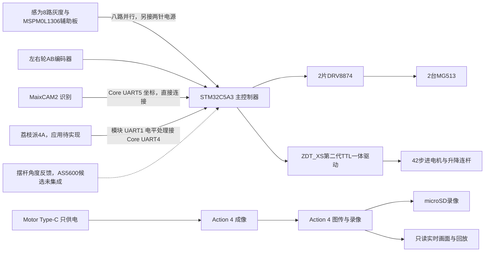

# A 题方案大纲

初稿：2026-11-03；双摄方向更新：2026-11-05。
2026-11-11 状态整理：当前 M2.8P2 保留荔枝派 4A、MaixCAM2 识别和 Action 4 图传，荔枝派应用职责待确定。
当时 Motor 已完成主要布线并核对有效焊盘网络，仍有 DRC 和功率布局问题；该历史结论不覆盖后续用户保存的 PCB。
见[PCB 复查](../validation/2026-11-10-motor-pcb-review.md)。
2026-11-16 已进入焊接后的实物联调，LL 固件已验证两轮主动转动、编码器、连续步进和蓝牙接收，并支持默认 ALL 页按 RUN 连续联动、再按停止；证据及原 PA3/唤醒时序问题见[轮驱动联调记录](../validation/2026-11-16-wheel-drive.md)。
日常程序更新已切换为 [HC-08 无线烧录](../how-to/wireless-update.md)。上述 11 月 16 日记录仅描述当时的外设联调与升级通路。

11 月 18 日的循线版本以 CH4/CH5 中点为目标，通过 A 点横线停车。11 月 20 日比赛版改用按键位置为起点、编码器里程为终点，实车一圈 13.056 s，停稳位置误差待尺量。第一题已完成 640 像素五点标定、电机轴限位与三点稳球控制，现场新识别算法的复测是当前优先项。[第二题验证](../../Firmware/validation/2026-11-20/task2-distance.md) · [第一题验证](../../Firmware/validation/2026-11-20/task1-recovery.md) · [当前交接](../../.agent/main/handoff.md)

## 对照比赛要求

| 任务 | 赛题要求 | 对应设计与验收 |
| --- | --- | --- |
| 静止移球 | O→+5cm→−5cm，≤8s，正文误差≤2cm | 钢球位置外环、摆杆角度内环；按评分表更严格的≤1.5cm验收 |
| 循迹停车 | 顺时针一圈≤30s，A 点停车偏差≤3cm | 八路灰度、轮速闭环、按键定起点与编码器里程终点 |
| 载球半圈 | A→B≤12s，球偏差≤2cm | 限加速度轨迹、弯道降速、钢球闭环 |
| 载球整圈 | ≤40s，球偏差≤2cm | 联合控制，记录位置与速度数据 |
| 任意位置稳球 | ±5cm 内指定位置，行驶一圈，误差≤2cm | 一键启动前本地设置目标，运行中自主控制 |
| 图传录像 | 实时显示球运动，完整测试录像可回放 | Action 4 图传与录像，功能仍待验证 |

赛道周长按两段 1.5m 和半径 0.5m 的两个半圆计算，约 6.142m。
对应 30s 一圈的平均速度至少约 0.205m/s，12s 半圈约 0.256m/s。
建议首轮目标速度为 0.30～0.40m/s，曲线与加减速余量由实车确定。
这些是设计计算，不是整车已达成的性能。

赛题要求摆杆一端铰接，另一端由机构改变角度。
机械设计遵守端部铰接，不采用中心支点替代。
摆杆长度不小于 25cm，离平板高度不小于 5cm。
PDF 写钢球约 18mm，器材清单写约 1cm；探头高度和槽宽必须可调，以赛场钢球为准。
正文和评分表的静止定位误差也有差异，内部采用更严格指标。

## 系统架构

主控制器不依赖网络、上位机或视频链路完成循迹和稳球。
网络页面不提供测试过程中的运动遥控。
MaixCAM2 的 V2 绝对坐标已经接入第一题闭环。五点标尺及主控丢球恢复有实车记录，新识别版本的连续漏检时长与端到端延时仍待测。Action 4 负责独立图传录像。[相机工程与标定](../../Firmware/26h/README.md)

## 元器件如何分工

| 功能 | 方案 | 集成位置 |
| --- | --- | --- |
| 轮驱动 | 保留 DRV8874 的 PH/EN、IPROPI、nFAULT 和限流 | Motor 主板 |
| 轮编码器 | 六针插座、现有 SN74LVC2G17 整形 | Motor 主板 |
| 循迹 | 感为八路灰度＋MSPM0L1306 辅助板 | 车底探头；Motor 读取辅助板数字输出，J20 八路输出及 J21 两针供电 |
| 摆杆执行 | ZDT_XS 第二代 TTL 驱动与电机一体套件 | 本轮驱动外置，Motor 预留控制和电源，电机固定在底盘 |
| 摆杆角度 | AS5600-ASOT、径向充磁磁铁，候选未集成 | 原理图未画入，接口资源及机械安装仍需规划 |
| 荔枝派 | 荔枝派 4A，应用分工待明确 | J25 五伏 Type-C，J18 模块 UART1 接 Core UART4；保留 Maix 识别 |
| 钢球位置 | MaixCAM2 识别 | J19 同序六针，经 Core UART5 接收坐标；识别与充电取电能力须实测 |
| 图传 | Action 4 | J28 Type-C 仅供电，固定五伏；图传、录像及边用边充待实测 |
| 配套 | 已画入 TFT、四键、HC-08 及独立三伏三 LDO；蜂鸣器和电压采样属后续候选 | 当前 Motor 原理图及后续小板 |

详细型号、采购编号、价格条件和替代项见[器件选型](../reference/parts-selection.md)。
Motor 有十页原理图。11 月 21 日复查时，原生 ERC 无报项，PCB DRC 和资源检查仍有失败项。停车稳球和循线均已进入实测，载球行驶、图传回放和定位误差还需按竞赛条件验收。[工程核验](../validation/2026-11-21-handoff.md)

## 技术展示重点

1. 标定图像坐标到摆杆毫米坐标，记录反光、运动模糊、延时和丢球条件。
2. 把轮速、循迹、摆杆角度和球位置分层控制，展示每层误差与采样周期。
3. 利用驱动电流反馈识别异常负载，展示限流、故障响应和控制恢复过程。
4. 在载球行驶中限制加速度和转向变化，比较补偿前后的钢球最大误差。
5. 录像叠加时间戳、目标位置、实际位置与测试编号，保留可回放证据。

技术贡献通过电路、标定和对照数据体现，不以增加芯片数量作为目标。

## 先后顺序与完成条件

| 阶段 | 交付 | 完成条件 |
| --- | --- | --- |
| P0 接口和资料 | 六针电机原理图、接口表、选型和机械参数 | 原生网表确认针序，实物线束另行导通确认 |
| P1 静止稳球 | 识别链路确认、摆杆单轴样机 | 先完成坐标标定、丢球与延时检查，再完成≤8s移球任务 |
| P2 循迹 | 前置阵列、轮速闭环、停车检测 | 单独完成≤30s一圈及≤3cm停车 |
| P3 联合 | 载球半圈、整圈 | 满足时间与误差要求，记录全部试次 |
| P4 发挥 | 指定位置、图传、录像 | 控制不断帧，录像覆盖完整测试并可回放 |
| P5 集成 | M2完整原理图、PCB、机械总装 | 实板供电、热、干涉及赛道验收完成后再发布 |

P1 已取得两轮 8 s 内完成和一轮长时间等待视觉的记录。P2 已取得整圈时间，待实测 3 cm 停车误差。P3～P5 仍需完成各自的整车验收。
设计报告按“需求、方案比较、电路、机构、控制、标定、测试与误差”组织。
