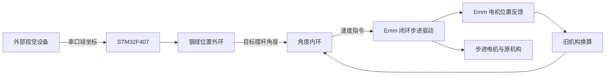

# 同学平衡球代码与当前方案的关系

这份解读基于同学提供的 `26H 平衡球装置 天空星F4.zip`，用于比较控制思路。
资料总表见[同学资料索引](https://github.com/SmallCoral/c5-car/blob/e631797d99cd60486eccc874f66cc99cdf3f7496/Documentation/reference/classmate-materials.md)，包内路径见[电赛索引](https://github.com/SmallCoral/c5-car/blob/e631797d99cd60486eccc874f66cc99cdf3f7496/Documentation/26%E7%94%B5%E8%B5%9B/README.md)。
下面区分源码已经表达的行为、对当前项目的启发和仍未验证的部分。

## 同学 F407 从上电到开始稳球的顺序

1. `Core/Src/main.c:118` 开始依次初始化 OLED、轮电机、轮编码器、步进串口、接收缓冲区和相机串口，然后开启 TIM1 中断。主循环扫描灰度并运行按键菜单。
2. `UART/urt.c:19` 的 `Motor_X_Init()` 只为 USART3 启动单字节中断接收。`Maxicam_Init()` 为 USART2 做同样的事。启动区里的位置和速度示例都被注释。压缩包内有设置单圈零点和触发回零的驱动函数，应用启动路径没有调用它们。驱动自身存过哪些上电参数，压缩包没有记录。
3. `Partical/balance.c:7` 的初值是 `balance_state=0`、`chose_TI=2`。从启动页按键 2 进入第二个菜单，在这里键 4 轮换题号，键 3 开关稳球。`Hardware/menu.c:75` 中只有这个按键分支才打开平衡装置。循迹有独立开关。
4. TIM1 的基础周期为 5 ms。待机时每 10 ms 查询步进位置（`0x36`），每 20 ms 处理视觉缓冲。稳球开启后，固定中点分支 4 以 `x=160` 为目标，外环每 20 ms 算管角，内环每 15 ms 下发 F6 转速。原机构把管角零度关联到电机的参考位置，源码没有测量重力水平。原题分支 3 则先以 205 为目标，再在第 300 个基础周期切为 100。

[同学原始工程及按键说明](https://github.com/SmallCoral/c5-car/blob/e631797d99cd60486eccc874f66cc99cdf3f7496/Documentation/26%E7%94%B5%E8%B5%9B/26H%20%E5%B9%B3%E8%A1%A1%E7%90%83%E8%A3%85%E7%BD%AE%20%E5%A4%A9%E7%A9%BA%E6%98%9FF4.zip)

## 源码表达的控制链

`Partical/balance.c` 的位置外环读取 `site.X_0`，计算位置误差并对实际位置作差分阻尼。
输出限制在源码设定的 -3 到 +3，并作为 `keep_inter.Target`。
角度内环使用 `Now_Angle` 换算的机构角度，输出带方向的电机速度。
该链路在 MCU 端使用了电机位置反馈，电机内部闭环和 MCU 的稳球闭环是不同层次。

源码还包含题目切换、指定球位置、循迹、电机速度调节和 OLED 按键交互。
这些是旧工程的逻辑，不是当前 C5 固件已经实现的功能。

## 同学原版与 C5 前版

本车 BALANCE 采用原包 `Partical/balance.c` 的 `best_hard()`、`Keep_Blance_out()`、`trace_balance_inter()` 及两个 PID 函数。固定回中采用第 4 题分支，原包的第 3 题会按时间切换目标。移植保留原控制函数及系数，通过适配层连接 C5 的相机和 Emm 串口。[原控制函数](../../Firmware/ports/classmate_26h/balance.c) · [C5 适配](../../Firmware/src/balance.c)

| 环节 | 我们先前的定位版 FDAB6530 | 当前移植的同学转速版 |
| --- | --- | --- |
| 球位外环 | 在新相机帧到达时按实际间隔算球速，有倾角补偿和脱离静摩擦的脉冲 | 每 20 ms 计算一次，用相邻两次球坐标之差制动，比例 0.08、微分 0.4，输出目标管角 ±3° |
| 步进输出 | 向驱动发送 FD 绝对轴位和 3～30 rpm 的速度上限 | 每 15 ms 根据估计管角误差算带符号的转速，比例 8、微分 0.7，死区 0.5°，F6 限幅 ±50 rpm |
| 初始位置与球丢失 | 从已知停放位可先走一段测过的行程，再进入局部定位 | 从当次轴位参考起步。短暂丢球沿用上次坐标，C5 对更长的丢球和反馈超时发停车指令 |
| 本车方向 | 两个版本共用实物左负、右正约定 | 实物中点 x=135 对齐原任务 160，静止球偏右时发 CCW 抬右端，偏左时发 CW。首次差分用首个有效球位初始化 |

用主控相机解析代码回放操作者标明位置的原始记录，最左的 27 帧都落在左端，正中的 36 帧都落在中点。重新上电后标为最右的 39 帧中，21 帧确认在右端，18 帧等待连续观测。另一次从实物最左开始记录的 221 帧里，零星高读数没有触发右端标记。[实物标点与回放读数](https://github.com/SmallCoral/c5-car/blob/e631797d99cd60486eccc874f66cc99cdf3f7496/Firmware/validation/2026-11-18/ball-ruler.json)

原版 `motor_X.c` 用 65535 将编码器读数换为轴角，再由 `trace_balance_inter()` 使用 `-(轴角 / 360 × 3200 × 0.039)` 估计管角。本车实际驱动设置为 3200 脉冲/转。管角换算系数仍是同学机构的值。F407 的名义调度来自 5 ms 的 TIM1，编码器目标查询周期 10 ms。C5 按同样的三个周期在主循环调度，串口传输逐条等待应答。[原压缩包](https://github.com/SmallCoral/c5-car/blob/e631797d99cd60486eccc874f66cc99cdf3f7496/Documentation/26%E7%94%B5%E8%B5%9B/26H%20%E5%B9%B3%E8%A1%A1%E7%90%83%E8%A3%85%E7%BD%AE%20%E5%A4%A9%E7%A9%BA%E6%98%9FF4.zip)

用相同的球位、模拟轴位与起始状态分别运行原包和 C5 适配层。36 秒主机回放中，2400 次内环的目标管角、估计管角和带符号整数 rpm 全部一致。旧固定速度定位版一次实测在 2.427 秒进入调节，42.575 秒时因步进串口接收错误抱停，末 5 秒为 x=100～102。后续 FDAB6530 缺少有效稳球用时。本次转速版只做静态板上验收，还没有实物稳住用时可与前版比较。[移植验证](https://github.com/SmallCoral/c5-car/blob/e631797d99cd60486eccc874f66cc99cdf3f7496/Firmware/validation/2026-11-18/f407-speed.json) · [前版试车记录](https://github.com/SmallCoral/c5-car/blob/e631797d99cd60486eccc874f66cc99cdf3f7496/Firmware/validation/2026-11-18/stationary-balance.json)

## 与早期 A 题草案的关键区别

| 环节 | 同学代码 | 当前 A 题草案 |
| --- | --- | --- |
| 主控 | STM32F407 | STM32C5A3VGT6 |
| 钢球位置 | 外部视觉设备发送串口坐标 | 32 路红外对射光栅方案 |
| 角度来源 | 电机反馈经旧机构系数换算 | AS5600 安装在摆杆实际铰轴 |
| 执行器驱动 | Emm V5.0 专用通讯控制 | TMC2209 STEP/DIR 方案 |
| 图像处理 | 本 ZIP 只有 MCU 接收与解码部分 | 图传与稳球检测分别规划 |

旧代码说明“视觉位置外环加电机反馈内环”是一条已有实现参考。
它为比较方案提供代码依据，但没有证明当前环境下视觉检测、时延或机械精度满足比赛要求。
是否改用 Emm、是否改用视觉和是否更换机械传动，是三个独立决策。

## 值得参考的结构

位置外环输出目标倾角，角度内环输出执行器速度，便于分别调试球的运动和机构跟随。
外环对测量位置求差分，可避免仅在目标值改变时产生大的差分动作。
但源码差分没有显式除以采样周期，数值参数与旧调度周期绑定。

原工程把稳球、循迹、菜单和反馈查询分别组织为函数。
`Core/Src/main.c` 中视觉解析和位置外环每 4 个基础调度调用一次，角度内环每 3 个调用一次，电机位置查询每 2 个调用一次。
这反映了分频调度思路；这些计数不能直接当作毫秒值或传感器实际更新率。
最终周期还取决于原平台时钟、定时器和通信延迟。

## 移植前需要重新确定的内容

| 证据位置 | 源码现状 | 对当前项目的影响 |
| --- | --- | --- |
| `Partical/balance.c` 的 `trace_balance_inter()` | `-(Now_Angle / 360 * 3200 * 0.039)` 换算机构角度 | `3200`、`0.039` 和方向均与旧机构/设置有关，不能作为通用比例 |
| `Partical/balance.c` 的 `Keep_Blance_out()` | `X_0 == 0` 时沿用上次位置 | 无球与坐标 0 混用；需明确数据有效性和超时行为 |
| `step_motor/motor_X.c` 的 `motor_complete_data()` | 使用 `65535` 将回传位置换为角度 | 与实物固件的字段单位、符号和零位一起核对，不能只凭变量名解释 |
| `UART/urt.c` 的接收状态机 | 用 `0x6B` 判尾，数组写入没有完整上限检查 | 可能在负载字节相同或异常长帧时提前截帧/越界，需要按协议长度组帧 |
| `step_motor/motor_X.c` 与定时回调 | 混用阻塞 UART 发送、DMA 查询及 DMA 控制 | 移植需统一发送调度、忙状态和超时，避免回调内长时间占用 |
| `Maxicam/maxicam.c` 与 `Buffer*` | MCU 提取视觉坐标，没有摄像头端识别应用 | 不能据此直接复现完整视觉链路；需要原视觉程序或重新实现 |
| `best_hard()`、循迹参数和 PID 初始化 | 固定目标像素、按题目切换的增益、旧标定注释 | 目标坐标、像素到毫米、限幅和增益都需要重新标定 |

上述内容是静态阅读结论，原文件没有修复或覆盖。
尤其是角度换算，仅凭源码无法确认旧机构的精确几何和回差。
即使采用电机闭环，连杆、皮带或丝杆中的间隙仍可能使电机角度与摆杆实际角度不同。

## 当前参考优先级

稳球部分优先参考双环职责、目标切换与限幅的位置。
通讯部分以所用驱动版本的协议为准，再比较旧发送/接收实现。
循迹部分参考状态组织，轮速和停车参数依当前底盘重新确定。
零位、真实倾角、失联停车和回零流程需要当前硬件验证。

现阶段没有把任一旧工程编译为 C5 固件，也没有确认新增驱动的采购、安装或最终选型。
当前实现状态仍由[根 README](../../README.md)和实际验证记录维护。
