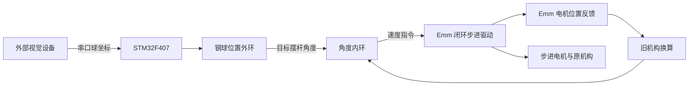

# 同学平衡球代码与当前方案的关系

这份解读基于同学提供的 `26H 平衡球装置 天空星F4.zip`，用于比较控制思路。
资料总表见[同学资料索引](../reference/classmate-materials.md)，包内路径见[电赛索引](../26电赛/README.md)。
下面区分源码已经表达的行为、对当前项目的启发和仍未验证的部分。

## 源码表达的控制链

`Partical/balance.c` 的位置外环读取 `site.X_0`，计算位置误差并对实际位置作差分阻尼。
输出限制在源码设定的 -3 到 +3，并作为 `keep_inter.Target`。
角度内环使用 `Now_Angle` 换算的机构角度，输出带方向的电机速度。
该链路在 MCU 端使用了电机位置反馈，电机内部闭环和 MCU 的稳球闭环是不同层次。

源码还包含题目切换、指定球位置、循迹、电机速度调节和 OLED 按键交互。
这些是旧工程的逻辑，不是当前 C5 固件已经实现的功能。

## 与现有草案的关键区别

| 环节 | 同学代码 | 当前 A 题草案 |
| --- | --- | --- |
| 主控 | STM32F407 | STM32C5A3VGT6 |
| 钢球位置 | 外部视觉设备发送串口坐标 | 32 路红外对射光栅方案 |
| 角度来源 | 电机反馈经旧机构系数换算 | AS5600 安装在摆杆实际铰轴 |
| 执行器驱动 | Emm V5.0 专用通讯控制 | TMC2209 STEP/DIR 方案 |
| 图像处理 | 本 ZIP 只有 MCU 接收与解码部分 | 图传与稳球检测分别规划 |

旧代码说明“视觉位置外环加电机反馈内环”是一条已有实现参考。
它为比较方案提供代码依据，但没有证明当前环境下视觉检测、时延或机械精度满足比赛要求。
是否改用 Emm、是否改用视觉和是否更换机械传动，是三个独立决策。

## 值得参考的结构

位置外环输出目标倾角，角度内环输出执行器速度，便于分别调试球的运动和机构跟随。
外环对测量位置求差分，可避免仅在目标值改变时产生大的差分动作。
但源码差分没有显式除以采样周期，数值参数与旧调度周期绑定。

原工程把稳球、循迹、菜单和反馈查询分别组织为函数。
`Core/Src/main.c` 中视觉解析和位置外环每 4 个基础调度调用一次，角度内环每 3 个调用一次，电机位置查询每 2 个调用一次。
这反映了分频调度思路；这些计数不能直接当作毫秒值或传感器实际更新率。
最终周期还取决于原平台时钟、定时器和通信延迟。

## 移植前需要重新确定的内容

| 证据位置 | 源码现状 | 对当前项目的影响 |
| --- | --- | --- |
| `Partical/balance.c` 的 `trace_balance_inter()` | `-(Now_Angle / 360 * 3200 * 0.039)` 换算机构角度 | `3200`、`0.039` 和方向均与旧机构/设置有关，不能作为通用比例 |
| `Partical/balance.c` 的 `Keep_Blance_out()` | `X_0 == 0` 时沿用上次位置 | 无球与坐标 0 混用；需明确数据有效性和超时行为 |
| `step_motor/motor_X.c` 的 `motor_complete_data()` | 使用 `65535` 将回传位置换为角度 | 与实物固件的字段单位、符号和零位一起核对，不能只凭变量名解释 |
| `UART/urt.c` 的接收状态机 | 用 `0x6B` 判尾，数组写入没有完整上限检查 | 可能在负载字节相同或异常长帧时提前截帧/越界，需要按协议长度组帧 |
| `step_motor/motor_X.c` 与定时回调 | 混用阻塞 UART 发送、DMA 查询及 DMA 控制 | 移植需统一发送调度、忙状态和超时，避免回调内长时间占用 |
| `Maxicam/maxicam.c` 与 `Buffer*` | MCU 提取视觉坐标，没有摄像头端识别应用 | 不能据此直接复现完整视觉链路；需要原视觉程序或重新实现 |
| `best_hard()`、循迹参数和 PID 初始化 | 固定目标像素、按题目切换的增益、旧标定注释 | 目标坐标、像素到毫米、限幅和增益都需要重新标定 |

上述内容是静态阅读结论，原文件没有修复或覆盖。
尤其是角度换算，仅凭源码无法确认旧机构的精确几何和回差。
即使采用电机闭环，连杆、皮带或丝杆中的间隙仍可能使电机角度与摆杆实际角度不同。

## 当前参考优先级

稳球部分优先参考双环职责、目标切换与限幅的位置。
通讯部分以所用驱动版本的协议为准，再比较旧发送/接收实现。
循迹部分参考状态组织，轮速和停车参数依当前底盘重新确定。
零位、真实倾角、失联停车和回零流程需要当前硬件验证。

现阶段没有把任一旧工程编译为 C5 固件，也没有确认新增驱动的采购、安装或最终选型。
当前实现状态仍由[根 README](../../README.md)和实际验证记录维护。
