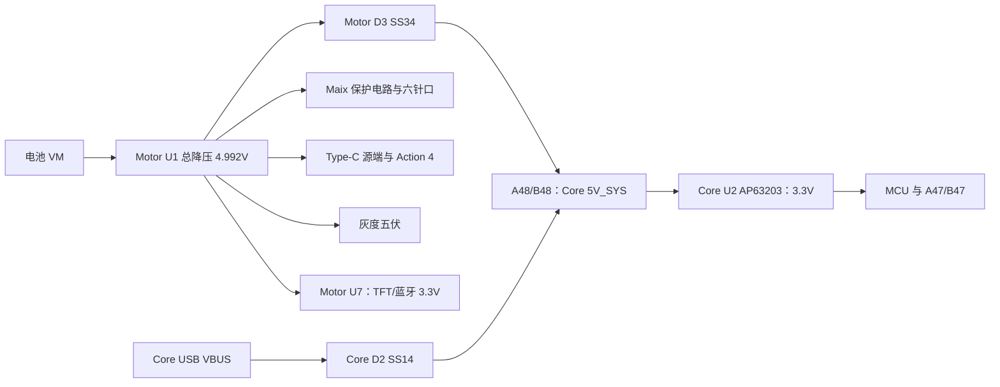

# M2.7 统一电源与相机接口核对

2026-11-07，KiCad 10.0.6，源码 HEAD `cc8dcdb9731c375813c00e5a12133c461657d29e` 加当前工作区修改。用户授权直接修改原理图及同步 PCB 元器件，未使用 computer-use。电路检查、PCB DRC、实物运行分别报告。

## 核心板供电

新导出的 Core 原生网表确认 J13:A48/B48 接 U2 VIN/EN；Core U2 为 AP63203WU-7，L1 后的 3.3V 接 MCU 及 A47/B47。A1/A49/B1/B49 为公共地。Motor D3 阳极接总降压、阴极接核心板；Core D2 阳极接 USB、阴极接同一系统电源。USB 不会经 D3 反供相机，电池电源不会经 Core D2 反供 USB。

Core 芯片标称 2A 不等于可分给外设 2A，共享接口对外 3.3V 预算仅 100mA。TFT 与 HC-08 合计预算 150mA，因此保留 AP2112K LDO，两路 3.3V 不并联。按 150mA 估算 LDO 功耗约 `(4.992−3.3)×0.15=0.254W`，温升须验证。Core USB 仅作低负载调试；本轮未修改 Core 原理图或 PCB。

## 统一降压与预算

Motor 删除 U6、L2、C51/C52/C53，复用 C50、R59/R60、C63，删除 C6。U1 换 TPS56837RPAR，MODE=30.1k，500kHz、高限流档；SS/PG 按手册允许悬空，默认软启动 1.8ms。反馈 73.2k/10k、均 0.1%，`Vout=0.6×(1+73.2/10)=4.992V`。C63=150pF、L1=3.3µH，C5 用 TI 表7-2 指定的 22µF/25V X7R 1210 Murata 料号。原厂表允许一颗最小输出配置，Type-C 输入另有本地大电容；有效容值、附加大电容对稳定性的影响和负载阶跃须实测。

| 五伏负载 | 设计电流 |
| --- | --- |
| Core，按五伏输入计 | 0.75A |
| Maix 六针口 | 1.00A，受连接器额定限制，非最大耗电实测 |
| Action 4 Type-C 通告 | 3.00A，端口能力预算，非相机耗电实测 |
| 灰度辅助板和本体 | 0.30A 预算 |
| TFT/蓝牙 LDO 输入 | 0.15A 预算 |
| 总计 | 5.20A |

轮电池端按 4A、步进输入按 3A、降压效率假定 85%。`Ibat=7+4.992×5.2/(Vbat×0.85)`：10V 为 10.0539A，12V 为 9.5449A，12.6V 为 9.4238A。F1 15A 按 75% 连续降额为 11.25A，高于预算；F2 4A 延时保留。还需验证启动脉冲、线束及故障分断。R3/R4=82k/10k 的 EN 典型开约 10.77V、关约 9.52V，低于启动门限不能期待从关闭状态正常开机。

8A 是芯片额定，不是本板持续输出实测。L1 744325330 的 12A/50K 温升与 15A/30% 降感典型值有各自条件。U1 为 3×3mm HotRod QFN，U16 为 WQFN，须有适合底部焊盘的焊接工艺。

## 相机与精简边界

MaixCAM2 作识别，J19 与模块 U56 同型号 ZX-MX1.25-6PWT，1～6 同序为 GND、保护 5V、SCL 不接、SDA 不接、模块 UART4_TX、模块 UART4_RX。TX 接 PC7/USART6_RX，RX 接 PC6/USART6_TX，保留旧网络名 VIDEO_RX/VIDEO_TX 以维持 GPIO 和布线合同。线束须逐针测 1→1 连通及安装方向，不能只看颜色。

六针座厂家额定 1A，因此 R72 改为 95.3k，SGM2531C 限流公式典型值 0.99859A。±5% 仅在 1A/25℃规定，不是全温限流上界恰好 1A。识别与电池充电叠加可能超过支路能力并反复启动，本轮没有证明六针口能满足满负载。需实测并限制相机充电/负载；不足时须调整供电接口，不能只提高限流。

U10 欠压约 4.504V；R70/R71=42.2k/15k，过压典型约 5.301V，仅计基准与 0.1% 电阻约 5.140～5.459V，另有漏电、温漂及动态误差。它是切断门限，不是精准钳位。C73 12nF 软启动典型约 11.7ms；U14 LTC4412 与 Q5 防反灌。模块内部六针 5V 与 Type-C VBUS 相通，普通带电 USB 调试前拔 J27，内部电池仍可能供电。

Action 4 仅从 J28 USB4125-GF-A 取电。U16 TPS25810 的 IN1/IN2/AUX/EN/CHG/CHG_HI 接五伏，REF 与 REF_RTN 间 100k/1%，CC1/CC2 分别接 A5/B5。检测接入后打开 VBUS，提供 3A 通告及限流。固定 5V，无 PD/PPS、无 USB 数据，不能承诺 DJI 30W 快充或所有录像模式下的边充边用。

C81 150µF±20%、最小 120µF，满足源端输入储能要求；C82 0.1µF 与 C83 10µF 分别在输入与端口。它们不是又一路降压。C81 16SVP150M 为国内现货但 NRND，原型可购，长期量产应重选。四键删除 C57～C60，保留 10k 上拉，固件需约 20ms 消抖；本轮未改固件。C1、C13/C33 保留，不能仅因同网就取消电机本地储能。

## 原厂依据与采购

- [TI TPS56837 SLVSGM3B，2024-01](https://www.ti.com/lit/ds/symlink/tps56837.pdf)：脚位、MODE、EN、默认软启动、表7-2、RPA0010A 焊盘。
- [TI TPS25810 SLVSCR1C，2017-07](https://www.ti.com/lit/ds/symlink/tps25810.pdf)：图20/§8.2 最小 5V/3A 源端及电容要求。
- [Würth 744325330，004.001，2025-02-06](https://www.we-online.com/components/products/datasheet/744325330.pdf)：额定电流条件及焊盘。
- [ZX-MX1.25-6PWT 图纸 Rev2.0](https://atta.szlcsc.com/upload/public/pdf/source/20230619/19BADCECEBF6C4BE7BE623B88E9F31F2.pdf)：1.25mm、1A、六针与固定焊盘；脚位另按项目内 Maix 官方原理图 U56。
- [GCT USB4125](https://gct.co/files/drawings/usb4125.pdf)、[Panasonic 16SVP150M](https://industrial.panasonic.com/ww/products/pt/os-con/models/16SVP150M)、[Sipeed MaixCAM2](https://wiki.sipeed.com/hardware/zh/maixcam/maixcam2.html)、[DJI Action 4](https://www.dji.com/osmo-action-4/specs)。

[国内库存快照](../../Hardware/stm32c5a3/Hardware/CoralC5-Motor/docs/procurement_m27.json)记录七类主要新器件的国内商品、C 编号、日期、库存及起订量，2026-11-07 查询时均有现货、1 个起购，未报价。U1 1725、U16 6128、J28 31、J19 27474、L1 15、C5/C50 52316、C81 62。库存会变化，尚未采购。精密阻容具体 SKU 查询返回 HTTP 405，仍按参数列通用需求，未选海外或订货替代，未声称均已核实时库存。[145 位号草表](../../Hardware/stm32c5a3/Hardware/CoralC5-Motor/docs/BOM_M2_SCHEMATIC_DRAFT.csv)不含两个机械孔，不是生产 BOM。

## 验证结果

修改前基线在 Motor `docs/baseline-2026-11-07-m27`，含用户 PCB、原理图及 SHA。同步前当前 PCB 已包含 M2.7 器件，另存 `pre-sync-latest.kicad_pcb` 后只补齐差异，没有回退旧板。

重新导出两板原生 XML 网表，执行 `sch erc --format json --severity-all --exit-code-violations`、`tools/verify_schematic.py`、PDF 导出及 `tools/check_visual.py`。历史 M2～M2.6 验证器保留；M2.7 从实时基线和独立逐针变更意图核对全部网络，并核对未改图页、UUID、98 触点、GPIO 复用及资源。2821 项通过，ERC 0 错误/0 警告；9 页渲染审阅，导线与文字、文字与文字交叠均为 0。

147 个实体位号含两孔，144 个绑定可解析模型，其中 10 个为明确声明的通用外形，J1 准确模型仍缺。U1/J19 定制焊盘按图纸，通用外形不代表精确端子或内部结构。

U1 VIN 主焊盘 X=+0.95mm、J19 固定焊盘 X=±5.225mm 已按原厂尺寸复核，并同步库和板内焊盘。PCB 修正 C2/R59 值和 R81:2/R82:1 的旧门极网名，并补回 48 个原有封装缺失的原理图 UUID 关联，147 个封装与原理图一致；摆放、UUID 及 154 段走线、过孔保留。`pcb drc --format json --severity-all --schematic-parity --exit-code-violations` 返回 **5**：一致性 0、DRC 18、未连接 305。包括 15 处 courtyard 重叠、J14 固定焊盘到 NPTH 0.05mm、缺板框和一个悬空过孔。没有隐藏问题或改低规则，仍需用户布线并复查，不能制板发布。

另运行只读 `tools/verify_pcb_sync.py`，1439 项通过，逐焊盘网络及所有现有位置、UUID、走线均核对。证据在 Motor `docs/pcb_sync_verification.json`、`docs/verification.json`、`visual_check.json`、`pcb_sync_m27.json`、`pcb-drc-m27.json`。未做实物上电、母线噪声、稳压稳定性、相机充电启动、温升、故障分断或整车运行测试。
