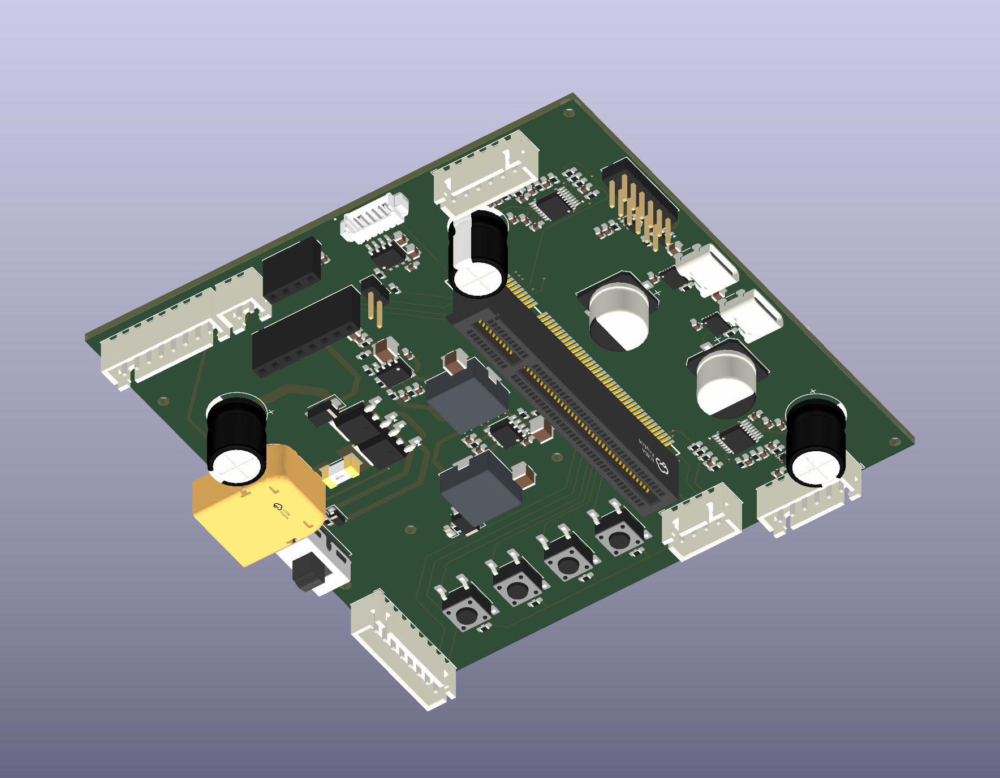

# 2026-11-09 Motor PCB 元器件 3D 模型

补入五个网上已有的 STEP 文件，更新七个器件的 PCB 内嵌模型和本地封装模型。
未自行建模，未缩放或编辑下载模型的几何。
SW1 与三只径向电解采用明确标注的其他厂家外形参考；尚未取得全部器件的精确原型号 CAD。

## 基线与范围

- 源码起点：`8725275ab4f3aace2bfe87971e3c5ed062f33165`，分支 `main`，包含此前未提交的引脚规划和用户 PCB 修改。
- 修改前保存 112 个工程、封装、模型及相关文件，路径为 `.scratch/models-20261109/before/`，SHA256 清单为 `.scratch/models-20261109/baseline.json`。
- 修改前 PCB SHA256：`89a2ec220ce0d86236412cf064f121cb4cb443ffa870d112ff9f2c04f1b26dac`。
- 实际起始板为 146 个封装，含 140 个电气器件、6 个机械孔；545 段走线、32 个过孔。此前 142 封装的报告是历史快照。
- 本轮只修改七个器件的 `(model ...)` 字段和五个本地封装的对应字段。去掉模型节点后，PCB 与本地封装的全部字段和基线一致，包括位号、UUID、位置、焊盘、网络、走线、过孔及板框。
- 原理图、BOM、Core 板及旧项目 `D:/dev/qrs/stm32/Coral-C5` 未修改。未运行生成器，未同步网表，未改变上轮 GPIO 规划。

## 模型来源与核对

下载原件、来源链接、日期、SHA256 和绑定参数集中在 [来源清单](../../Hardware/stm32c5a3/Hardware/CoralC5-Motor/docs/models-2026-11-09.json)，许可来源见 [模型目录说明](../../Hardware/stm32c5a3/Hardware/CoralC5-Motor/Models/README.md)。
新增 STEP 均可由 OpenCascade 读取，实体有效性检查通过，文件 SHA256 与下载原件相同。

| 器件 | 原问题 | 当前模型及核对结果 |
| --- | --- | --- |
| J1 XT60PW-M | PCB 与本地封装没有模型 | 嘉立创EDA/EasyEDA 官方库 C98732 对应料号 STEP；电源脚径 2.6mm、脚距 7.2mm，正极对准当前 2 脚。两个安装片中心相对现有孔约差 0.05mm；模型外轮廓与当前 Fab 约有 0.2mm 差异，不能据此反向改焊盘 |
| F1 0448015.MR | 使用 `Fuse_454_generic.wrl` 方块 | C187551 对应料号 STEP，外形 6.1×2.7×2.7mm；Z 平移 1.35mm 使底面落在板面，替换错误系列占位 |
| J19 ZX-MX1.25-6PWT | 无端子、无开口的方块 | C7430472 对应料号 STEP，信号脚距 1.25mm；信号焊脚中心对当前焊盘约差 0.01mm。原生模型安装片底面中心约为 X=±5.625mm，当前焊盘中心为 ±5.225mm，外侧约 0.125mm 超出焊盘；模型与当前 Rev2 图纸不是完全一致的机械依据，本轮不改焊盘 |
| SW1 SS12D10G5 | 自绘简化方块 | 使用既有 DEALON SS-12D10-G5/C2998777 外形参考。壳体长宽 12.7×6.7mm、手柄 5mm；整体高 11.4mm，对比 SHOU HAN 图纸约 11.6mm。模型脚距 4.7mm，当前封装为 4.8mm，外侧脚中心各差 0.1mm。保留这些原始差异，未把它标为 SHOU HAN 精确模型 |
| C1/C13/C33 EEU-FR1E471 | 通用模型本体只有 10mm 高 | 改用 Nichicon 官方 D10×L12.5/P5 径向模型。Panasonic 官网确认原器件为 D10、L12.5、P5。负极条纹及短脚朝当前 2 脚；原下载模型的 15/19mm 未剪引线保留，不能据此判断板下装配净空 |

尺寸依据：[Panasonic EEUFR1E471](https://industrial.panasonic.com/ww/products/pt/aluminum-cap-lead/models/EEUFR1E471)、[SHOU HAN 图纸原件](../../Hardware/stm32c5a3/Hardware/CoralC5-Motor/docs/sources/SS12D10G5_SHOUHAN.pdf)、[Nichicon 官方模型库](https://www.nichicon.com/en-us/design-support/3d-model-library/?page=2)。
嘉立创EDA/EasyEDA 官方库来源：[嘉立创EDA](https://lceda.cn/)、[EasyEDA](https://easyeda.com)。

## 保留项与没有采用的模型

- SW2～SW5 当前名为 `SW_Push_6x6x4.3mm_SMD_Generic.step`，实际与本轮从 KiCad 官方下载的 `SW_Push_1P1T_NO_E-Switch_TL3301NxxxxxG.step` 逐字节一致，SHA256 为 `481b6420fcfc668cbad880c1ed5aad067d341adc9f3aaa28925464d9637728bc`。保留现有模型；它仍不能确认无品牌实物按键的实际料号和引脚形状。
- J14 原插槽文件与 C21263085 现成模型尺寸一致，既有 X=-13.5mm 绑定用于对齐当前封装原点，保留。
- C81/C92 的 Panasonic 16SVP150M 实际高 7.9mm。C178346 供应商页面关联的现成模型却为 H10.2，未采用；保留现有 7.9mm 模型。依据：[Panasonic 产品尺寸](https://industrial.panasonic.com/ww/products/pt/os-con/models/16SVP150M)。
- C7431054 的模型实际名为 SS12D10G4，手柄仅 4mm，未冒充 G5。另查到的两个 D10×L12.5 电容商品模型分别有 16mm 或更大本体，未采用。
- U1/U6 AP64500SP-13 和 U10 SGM2531CXPS8G/TR 保留原 KiCad 通用 SOIC 外形，底部 EP 细节尚不精确。[Diodes 原厂封装页](https://www.diodes.com/package/view/374.info)确有 SO-8EP STEP 下载入口，但命令行得到网站验证页，浏览器两种正常下载方式均超时，未取得文件。SGMICRO 官网提供封装图纸，未找到可取得的原型号 STEP。其他候选 HSOP/HTSOP 模型高度仅 1.1mm，与本器件不符，未换入。
- Core 板资源只读检查未发现缺失文件；金手指 J13 与 LOGO1 没有独立器件模型属于正常情况。未修改 Core。

## 验证结果

| 范围 | 结果 |
| --- | --- |
| PCB 模型资源与本地库 | [终检 319 项通过](../../Hardware/stm32c5a3/Hardware/CoralC5-Motor/docs/models-2026-11-09-check.json)；140/140 电气封装绑定本地存在的模型；6 个机械孔按封装类型豁免 |
| 下载模型 | [五个 STEP 读取及有效性通过](../../Hardware/stm32c5a3/Hardware/CoralC5-Motor/docs/models-2026-11-09-geometry.json)；原始文件内容不变 |
| 布局与铜线 | 模型节点以外全部字段与本轮基线一致；545 段走线、32 个过孔保留 |
| 原生 PCB DRC | 修改前后均为 **24 条违规、156 项未连接，未通过**；24 条违规内容一致。未连接报告选择的部分代表端点不同，因此不声称两份报告逐条相同 |
| 原理图 ERC | 本轮没有原理图变更，未重跑 ERC；不把模型检查作为电气检查 |
| 渲染 | KiCad 原生顶视及斜视检查，核对 XT60 安装脚、连接器开口、保险丝板面高度、电容极性与安装姿态 |
| 实物及精确机械配合 | 未验证；上述外形参考、长引线、安装片及 EP 限制保留 |

原生报告：[修改前 DRC](../../Hardware/stm32c5a3/Hardware/CoralC5-Motor/docs/models-2026-11-09-drc-before.json)、[修改后 DRC](../../Hardware/stm32c5a3/Hardware/CoralC5-Motor/docs/models-2026-11-09-drc-after.json)。
没有改动 DRC 忽略规则或豁免既有违规。

## 工具与复现

日期为 2026-11-09；KiCad CLI/pcbnew 10.0.8、KiCad Python 3.11.5，STEP 只读核对使用 `cadquery-ocp-novtk 8.0.1.1.0`。

```powershell
$motor = 'Hardware/stm32c5a3/Hardware/CoralC5-Motor'
$base = '.scratch/models-20261109/before/Hardware/stm32c5a3/Hardware/CoralC5-Motor'
& 'D:/KiCad/10.0/bin/python.exe' -B -X utf8 "$motor/tools/verify_3d_models.py" --baseline "$base/CoralC5-Motor.kicad_pcb" --baseline-library "$base/Motor.pretty"
& 'D:/KiCad/10.0/bin/kicad-cli.exe' pcb drc --format json --output "$motor/docs/models-2026-11-09-drc-after.json" "$motor/CoralC5-Motor.kicad_pcb"
& 'D:/KiCad/10.0/bin/kicad-cli.exe' pcb render --output "$motor/docs/3d-models-2026-11-09-isometric.png" --width 1800 --height 1400 --background opaque --rotate '45,0,35' --zoom 0.78 --quality basic "$motor/CoralC5-Motor.kicad_pcb"
```

没有本地基线时可省略两个 `--baseline*` 参数，只检查资源和下载文件，不能据此声称布局对比通过。
初次资源检查曾把本地 `Motor:MountingHole_*` 机械孔当作缺失模型报六项失败；修正封装类型识别后执行上述终检。该修正没有豁免电气器件。


