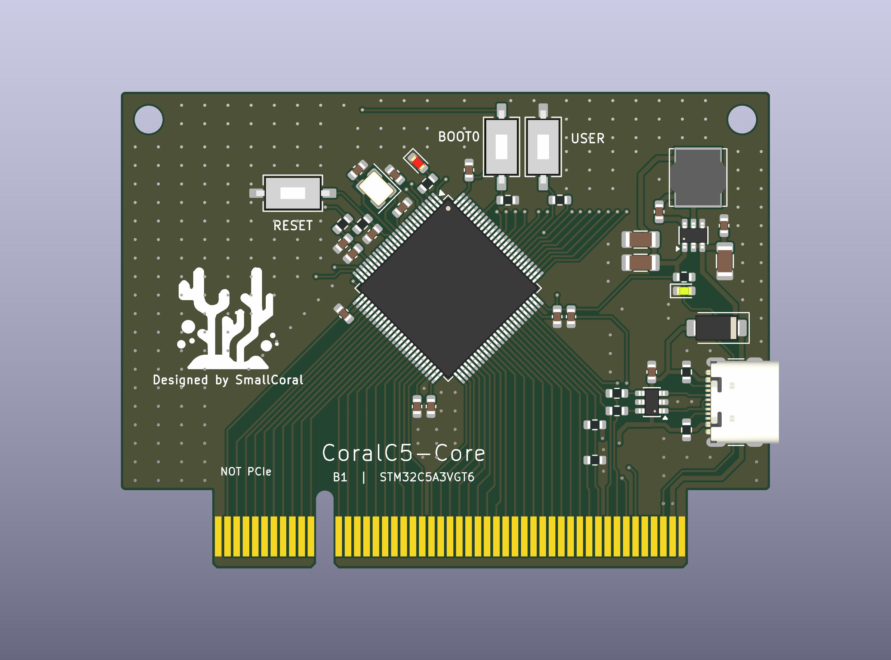

# CoralC5-Core

用 KiCad 10 打开 CoralC5-Core.kicad_pro。本板保留 STM32C5A3VGT6 最小系统、24MHz HSE 晶体、独立 3.3V 降压、USB-C、复位与 BOOT、用户按键和两颗 LED，通过 J13 金手指插入 Expansion。

正面丝印已补上 RESET、BOOT0 和 USER，用户按键接 PD2。左侧空白处放了从 Coral-Wave 沿用的珊瑚 Logo，下方署名 Designed by SmallCoral。图案转换成 11mm 单色轮廓，封装和来源放在 [Logo 说明](../Shared/branding/README.md)，可在 KiCad 中整组移动。

核心板已改为 1.60mm 双层板，只保留 F.Cu 和 B.Cu。原先两个内层没有走线或铜皮，已按用户要求删除；顶底层已有布线、通孔和器件摆放保留。

过孔间距按嘉立创双层 FR4、1oz 常规打样配置。过孔铜环到其他铜为 0.15mm，孔到铜及过孔孔边距为 0.20mm，有铜插件孔参与的孔边距保留 0.45mm。具体来源及适用条件见 [打样规则](docs/fabrication_rules.md)。复制工程时也要带上 CoralC5-Core.kicad_dru。

板形与接点直接沿用固定版本的 Streamline SL_BOARD，外框为 70.00×51.45mm。初始摆放参考 [H562 实物照片](https://stm32world.com/wiki/Streamline_MCU_STM32H562)，此后由用户继续调整和布线。MCU 保持 −45°，24MHz 晶体在主控左上，VREF 滤波集中在左侧，五颗 VDD 去耦分别对应各组电源脚，VCAP 电容留在下方。降压电源、USB-C、ESD 和供电二极管位于右侧，最新位置见下图。

照片中的 H562 使用 AMS1117，我们保留 AP63203 与电感，电源区按降压回路集中摆放。D3 是黄绿色电源灯，D4 是红色用户灯，PE3 高电平点亮。SW1、SW2、SW5 已统一改为两脚 3×6×2.5 贴片款，按 SD-1107 图纸绘制，实际本体 6.1×3.6mm，需与现有按键脚距核对。照片用于估计功能区域，具体走线和晶体回路仍需后续布局布线时复核。

四线 XH SWD 座放在 Expansion，顺序为 3V3／VTref、SWDIO、SWCLK、GND。当前保存的 Core 已移除 TP1 至 TP4，单独调试需从金手指或对应网络接线。BOOT0 保留 C5A3 的 PH2。Y2 及 C19、C20 已移除，当前没有外部 LSE 晶体。R45 至 R48 也已从原理图和 PCB 删除，PC14、PC15 直接连接 A16、A15；PH0、PH1 仅接 HSE，A14、A13 标为不连接。C5-EDGE-3 为自定义电气针序，除这两个空位外，信号顺序沿用 MCU 当前摆放对应的正面 B 排和背面 A 排。须配套使用同步更新后的 Expansion。

本板有四页原理图，见 [电路 PDF](docs/CoralC5-Core_Schematic.pdf)，元件清单在 [BOM.csv](docs/BOM.csv)。42 个采购位号均绑定本地模型，三个开关模型为标明来源的通用外形；J13 金手指属于板本身。JP1 已移除，USB_VBUS 直接接 D2 阳极，D2 保留反灌隔离；USB 供电仍仅用于低负载调试。

2026 年 10 月 23 日按用户最新要求保留 USB 的 R3、R4，均改为 0R，原理图与 PCB 一致。两颗电阻保留原来的 0603 封装、位置与布线，U3.6 经 R3 接 PA11，U3.4 经 R4 接 PA12。PCB 中已无先前临时添加的跨层走线和两个过孔，本次只修改这两个 PCB 阻值字段，其他走线、过孔、摆放和铜区均保持用户最新保存版本。0R 用作连接跳线；[DS15137 Rev3 第 5.3.28 节表 71 注 2](https://www.st.com/resource/en/datasheet/stm32c5a3vg.pdf#page=109)说明 USB 驱动片内已包含匹配阻抗。

2026 年 10 月 23 日复查结果为 ERC 0 错误、0 警告，原理图与 PCB 一致性问题为 0，308 个编号焊盘与最新网表一致。双板连通性和资源检查通过 2019 项，无失败项。这些检查不代表制板 DRC 已通过。

2026 年 10 月 24 日复查用户提交 88247a1，三条重叠线段已移除。Core 当前为 0 个 DRC 错误、0 个警告、0 个未连接项，一致性问题为 0。B49 地铜已接通，J2 地焊盘圆角半径 0.30mm 的修正仍保留，孔到铜约为 0.233mm。处理记录和原位置图见 [PCB 复查记录](docs/pcb_review.md)。C7 的 2.2µF／6.3V 标注仍低于 C5A3 对 VCAP 电容至少 10V 的要求，还需核对 3MHz 时小于 20mΩ 的 ESR。原厂条款和检查边界见 [双板全检记录](../Shared/full_review_2026-10-23.md)。
