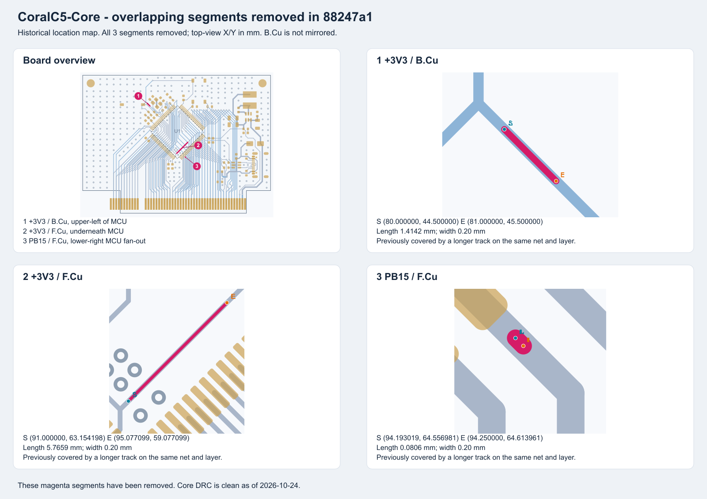

# Core PCB 复查记录

2026 年 10 月 24 日复查用户提交 88247a1，原先三条重叠线段均已移除。KiCad 10.0.6 重新填铜检查结果为 0 个错误、0 个警告、0 个未连接项，原理图与 PCB 一致性问题为 0。USB-C 地焊盘圆角修正仍保留，B49 接地也正常。本次只更新检查记录，没有改动 PCB 或原理图。

## USB-C 孔距已修正

J2 使用 GCT USB4105。参照 [厂家机械图 B4](https://gct.co/files/drawings/usb4105.pdf)，两处定位孔继续保留原孔位和 0.65mm 孔径，两个孔的中心为 120.635／64.660mm 和 120.635／70.440mm。连接器位置、外壳固定脚、信号脚和 3D 模型均沿用当前设计。

原来相邻地焊盘的圆角半径为 0.15mm，孔到铜只有约 0.1944mm。现在将两处实物地焊盘的圆角半径增至 0.30mm，对应 KiCad 中 A1／B12、A12／B1 四个重合的逻辑焊盘，圆角比例由 0.25 改为 0.5。焊盘中心和 0.60×1.15mm 外尺寸保持原样，形状接近长圆形，实测轮廓到孔边约为 0.233mm，高于工程要求的 0.20mm。这是本项目为制造间距作的焊盘形状调整，原厂图中的机械尺寸保留。

本地 DevBoard.pretty 中的封装和 PCB 内的 J2 已同步修改。四条孔到铜错误已消除，未降低检查阈值或添加排除项。对比本轮采用的最新 PCB，只有 J2 这四个圆角比例改变，其他走线、过孔、铜区、焊盘位置和器件位置一致。

## 已移除线段的原位置

图中粉色是多余线段，灰蓝色是正常走线，S、E 分别标出起点和终点。坐标采用 KiCad 电路板的 X、Y，单位为 mm；背面视图也沿用正面俯视坐标，没有镜像。图形直接从当前 PCB 的走线、过孔和焊盘轮廓生成，可打开 [SVG 原图](pcb_review.svg) 放大查看。

| 编号 | 网络和铜层 | 起点 X、Y mm | 终点 X、Y mm | 长度 mm | 大致位置 |
| --- | --- | --- | --- | --- | --- |
| 1 | +3V3，B.Cu | 80.000000，44.500000 | 81.000000，45.500000 | 1.4142 | 主控左上方的背面 |
| 2 | +3V3，F.Cu | 91.000000，63.154198 | 95.077099，59.077099 | 5.7659 | 主控下半部分的下方，位于芯片本体投影内 |
| 3 | PB15，F.Cu | 94.193019，64.556981 | 94.250000，64.613961 | 0.0806 | 主控右下方扇出区 |

这三段原先完全叠在同网、同层、同线宽的较长走线上，没有额外伸出的分支，所以整板视图里很难看见。它们曾触发 track_dangling 警告，并不表示这三路网络断线。2026 年 10 月 24 日复查确认，三段对应的 UUID 均已不在用户最新 PCB 中，三条警告全部消失。

下面保留原来的完整长线坐标，供回看处理过程。当前不需要再按旧图删除走线，最新 DRC 已没有这些警告。

| 编号 | 应保留的正常长线起点 X、Y mm | 应保留的正常长线终点 X、Y mm |
| --- | --- | --- |
| 1 | 81.000000，45.500000 | 79.500000，44.000000 |
| 2 | 95.077099，59.077099 | 90.654198，63.500000 |
| 3 | 94.193019，64.556981 | 94.592857，64.956819 |

## 仍需留意

C7 的 2.2µF／6.3V 标注仍需按 C5A3 对 VCAP 的要求改选至少 10V、并满足 ESR 要求的器件。Expansion 仍是未布线模板，插槽固定焊盘孔距和去耦布局待处理。原理图、器件规格和两板人工核查依据见 [当日全检记录](../../Shared/full_review_2026-10-23.md)，其中 18 时的 DRC 数字属于当时快照，当前 Core 结果以本页及 drc.json 为准。
