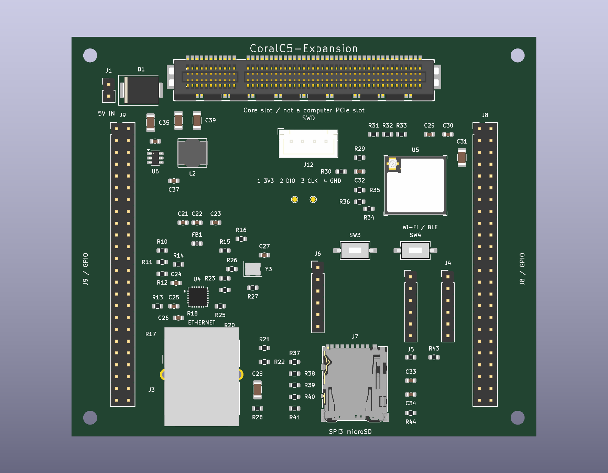

# CoralC5-Expansion

用 KiCad 10 打开 CoralC5-Expansion.kicad_pro。这是 Coral-C5 的单槽扩展板，顶部 J14 接核心板，左右 J9、J8 各一组 2×24 排针，下方放 RJ45 和 microSD，右侧放 ESP32-C3-MINI-1U。100×86mm 板框为本项目暂定尺寸。

板上包括 LAN8720A 百兆网口及 50MHz 时钟、SPI3 microSD、带 MHF III 外置天线座的 Wi-Fi／Bluetooth LE 模块、5V 入口和独立 AP63203 降压。J1 输入稳压 5V、2A，U6 的 +3V3_EXP 给本板外设供电；金手指和排针上的 +3V3 来自 Core，外接负载预算合计 100mA，两路输出不并联。J14 已同步 C5-EDGE-3 自定义针序，须与同版 Core 配对。J9 的 31、32 脚直接连接 Core 的 PC14、PC15，33、34 脚不连接；PH0、PH1 留在 Core 晶振回路。其余排针顺序保持原样，共引出 84 路 GPIO。

J12 是四线 SWD，JST XH 2.50mm，顺序固定为 1 脚 3V3／VTref、2 脚 SWDIO、3 脚 SWCLK、4 脚 GND。TP5 为 NRST，TP6 为 VREF_MCU。SW3、SW4 是 ESP 复位和下载按键，已改为两脚 3×6×2.5 贴片款，参考 SD-1107 图纸，本体实际 6.1×3.6mm、高 2.5mm。

本板有七页原理图，见 [电路 PDF](docs/CoralC5-Expansion_Schematic.pdf)，排针与金手指对应关系放在 [header_pinout.csv](docs/header_pinout.csv)，元件清单在 [BOM.csv](docs/BOM.csv)。73 个采购位号均绑定本地模型，其中 U4、J3、Y3 和两个按键使用通用外形，两个测试点不需要采购模型。

ERC 为 0 错误、0 警告，PCB 与原理图一致性检查为 0。PCB 尚未布线，有 314 个未连接项；J14 的 51 号固定焊盘到定位孔只有 0.05mm，低于当前 0.25mm 规则，需按母座原厂推荐焊盘复核修订。当前文件不作为制板发布版，接口边界和待处理项目见 [共同说明](../Shared/interface.md)。

2026 年 10 月 23 日全检确认当前电路与主控接口对应，PCB 仍未布线。PHY、无线和 SD 卡的部分去耦电容离电源脚约 7～16mm，需要在布线前重排。详细距离和全检结果见 [双板检查记录](../Shared/full_review_2026-10-23.md)。
