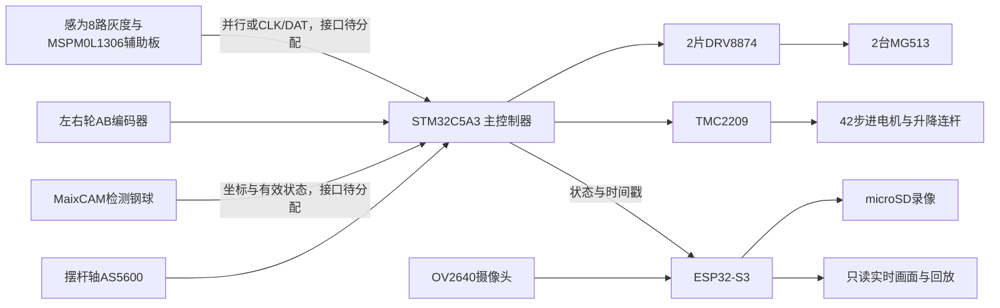

# A 题方案大纲

初稿：2026-11-03；双摄方向更新：2026-11-05。
用户已确认采用两只摄像头，检测端为 MaixCAM，图传端沿用 OV2640 方案。当前先完成机械安装框架，视觉标定、通讯和电路仍待实施；此前光栅方案作为备选保留。参数依据见 [双摄参考](../reference/cameras.md)。
2026-11-06 用户进一步确认底部循迹使用感为无 MCU 八路灰度及 MSPM0L1306 辅助板，替代本大纲此前的 12 路自研探头草案，见 [模块清单](../reference/external-modules.md)。
目标是先完成基本四项，再完成任意位置稳球和图传录像。
推荐方案使用现有 STM32 核心板、两台 MG513 轮电机和一台现有 42 步进电机。
新增电路以自研 Motor 底板为主，光学和角度探头按机械位置做自研小板。

## 对照比赛要求

| 任务 | 赛题要求 | 对应设计与验收 |
| --- | --- | --- |
| 静止移球 | O→+5cm→−5cm，≤8s，正文误差≤2cm | 钢球位置外环、摆杆角度内环；按评分表更严格的≤1.5cm验收 |
| 循迹停车 | 顺时针一圈≤30s，A 点停车偏差≤3cm | 模拟灰度阵列、轮速闭环、起点识别与里程窗口 |
| 载球半圈 | A→B≤12s，球偏差≤2cm | 限加速度轨迹、弯道降速、钢球闭环 |
| 载球整圈 | ≤40s，球偏差≤2cm | 联合控制，记录位置与速度数据 |
| 任意位置稳球 | ±5cm 内指定位置，行驶一圈，误差≤2cm | 一键启动前本地设置目标，运行中自主控制 |
| 图传录像 | 实时显示球运动，完整测试录像可回放 | ESP32-S3 + 摄像头 + microSD，独立于控制闭环 |

赛道周长按两段 1.5m 和半径 0.5m 的两个半圆计算，约 6.142m。
对应 30s 一圈的平均速度至少约 0.205m/s，12s 半圈约 0.256m/s。
建议首轮目标速度为 0.30～0.40m/s，曲线与加减速余量由实车确定。
这些是设计计算，不是整车已达成的性能。

赛题要求摆杆一端铰接，另一端由机构改变角度。
机械设计遵守端部铰接，不采用中心支点替代。
摆杆长度不小于 25cm，离平板高度不小于 5cm。
PDF 写钢球约 18mm，器材清单写约 1cm；探头高度和槽宽必须可调，以赛场钢球为准。
正文和评分表的静止定位误差也有差异，内部采用更严格指标。

## 系统架构

主控制器不依赖网络、上位机或视频链路完成循迹和稳球。
网络页面不提供测试过程中的运动遥控。
MaixCAM 负责检测位置，OV2640 负责图传录像。两条链路独立规划；检测端的标定、丢球处理和端到端延时须先验证，再接入稳球闭环。

## 元器件如何分工

| 功能 | 方案 | 集成位置 |
| --- | --- | --- |
| 轮驱动 | 保留 DRV8874 的 PH/EN、IPROPI、nFAULT 和限流 | Motor 主板 |
| 轮编码器 | 六针插座、现有 SN74LVC2G17 整形 | Motor 主板 |
| 循迹 | 感为八路灰度＋MSPM0L1306 辅助板 | 车底探头；Motor 读取辅助板数字输出，接法待分配 |
| 摆杆执行 | 现有 42BYGH34-401A、TMC2209、回零及机械限位 | 驱动在 Motor，电机固定在底盘 |
| 摆杆角度 | AS5600-ASOT、径向充磁磁铁 | 端部铰轴小板，I²C 回 Motor |
| 钢球位置 | MaixCAM，镜头具体版本待核对 | 顶部升降支架俯视球槽；串口及供电待分配 |
| 图传 | ESP32-S3-WROOM-1-N8R8、OV2640、microSD | 自研图传电路；安装位置按 DVP 线长约束确定 |
| 配套 | 独立辅助 3.3V、蜂鸣器、启动及模式键、电池电压采样 | Motor 主板 |

详细型号、采购编号、价格条件和替代项见[器件选型](../reference/parts-selection.md)。
新增器件目前没有并入已验证的五页 Motor 电路，不能据此直接制板。

## 技术展示重点

1. 标定图像坐标到摆杆毫米坐标，记录反光、运动模糊、延时和丢球条件。
2. 把轮速、循迹、摆杆角度和球位置分层控制，展示每层误差与采样周期。
3. 利用驱动电流反馈识别异常负载，展示限流、故障响应和控制恢复过程。
4. 在载球行驶中限制加速度和转向变化，比较补偿前后的钢球最大误差。
5. 录像叠加时间戳、目标位置、实际位置与测试编号，保留可回放证据。

技术贡献通过电路、标定和对照数据体现，不以增加芯片数量作为目标。

## 先后顺序与完成条件

| 阶段 | 交付 | 完成条件 |
| --- | --- | --- |
| P0 接口和资料 | 六针电机原理图、接口表、选型和机械参数 | 原生网表确认针序，实物线束另行导通确认 |
| P1 静止稳球 | MaixCAM检测、摆杆单轴样机 | 先完成坐标标定、丢球与延时检查，再完成≤8s移球任务 |
| P2 循迹 | 前置阵列、轮速闭环、停车检测 | 单独完成≤30s一圈及≤3cm停车 |
| P3 联合 | 载球半圈、整圈 | 满足时间与误差要求，记录全部试次 |
| P4 发挥 | 指定位置、图传、录像 | 控制不断帧，录像覆盖完整测试并可回放 |
| P5 集成 | M2完整原理图、PCB、机械总装 | 实板供电、热、干涉及赛道验收完成后再发布 |

当前已完成 P0 的文档和六针原理图修改，P0 实物核对及后续阶段仍待执行。
设计报告按“需求、方案比较、电路、机构、控制、标定、测试与误差”组织。
