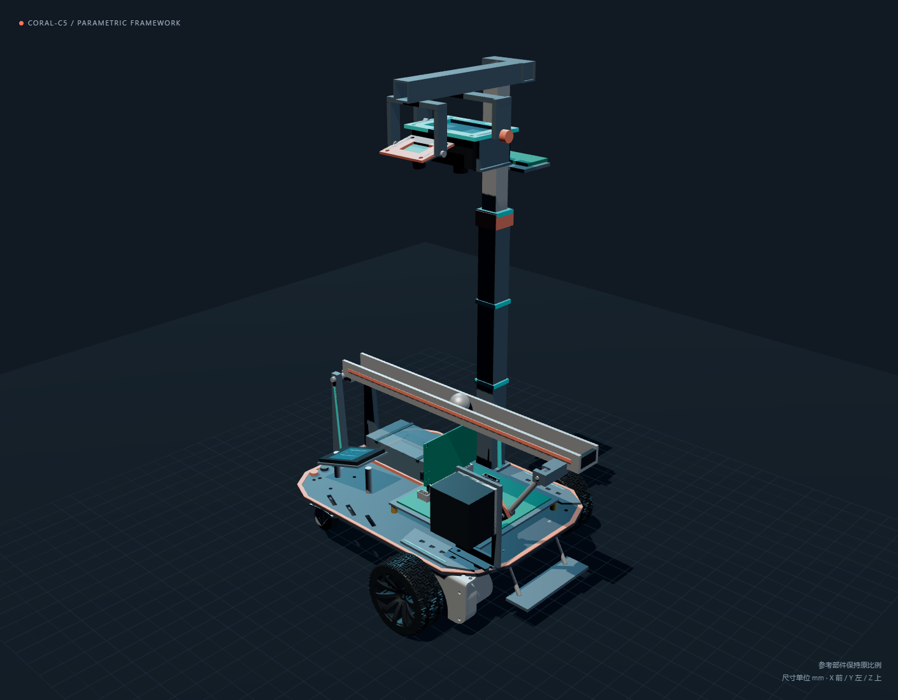

# Coral-C5 小车机械框架

2026-11-05 首版总装。按本次要求自行设计底盘，复用 EdgeMind 的编码电机、轮胎和万向轮，采用当前 Core 实际 PCB 和 99×99 mm Motor 规划外形。此版用于布局和机构讨论，尚未完成加工、承载及实物装配验证。



## 打开模型

| 用途 | 文件 |
| --- | --- |
| 可旋转查看、隐藏分组、摆杆运动、分解预览 | [查看模型.html](preview/查看模型.html)，用浏览器打开；保留同目录的 `vendor` |
| 原生可编辑总装 | [CoralC5_Framework.FCStd](source/CoralC5_Framework.FCStd)，FreeCAD 1.1.4 |
| CAD 交换模型 | [CoralC5_Framework.step](step/CoralC5_Framework.step)，毫米制、零倾角静态快照 |
| 带颜色的网格总装 | [CoralC5_Framework.glb](step/CoralC5_Framework.glb)，米制、零倾角静态快照 |
| 俯视、侧视和分解图 | [俯视](preview/preview-top.png)、[侧视](preview/preview-side.png)、[分解](preview/preview-exploded.png) |
| 参数与检查记录 | [parameters.yaml](parameters.yaml)、[本轮验证记录](../Documentation/validation/2026-11-05-mechanical-framework.md) |

## 当前尺寸与布局

| 项目 | 首版值及依据 |
| --- | --- |
| 底板 | 245×180×3 mm，切角轮廓、斜向开孔、侧翼护板、珊瑚色护边 |
| 驱动轮 | 参考 CAD 直径约 66.36 mm、宽约 26.04 mm，轮距暂定 210 mm；保持原比例 |
| 万向轮 | 复用参考轴、轮和转向座，重新建立平头空心隔柱；顶部止于底板下表面 |
| 电池位 | 直接提取用户 STEP 对应 `LowerTray` 的定位凸框，外框 91×53×3 mm、内框 87×49 mm |
| 电池本体 | 暂按内框边界及 25 mm 高画占位；高度、接头、间隙与电池绑带均待实物核对 |
| 电控 | Motor 99×99 mm 规划板居前；Core 板形 70×51.45 mm，按实际金手指方向竖插 |
| 操作台 | 按项目 TFT 规格书 35×56×3.5 mm 预留；暂画 4 个按钮和 HC-08 40×25×12 mm 空间 |
| 摆杆 | 280 mm 球槽、端部铰接、90 mm 铰轴高度；20 mm 曲柄、60 mm 连杆为本轮机构起点 |
| 摆杆执行结构 | L 形步进座、轴套、曲柄、错层连杆、叉耳及销轴；螺孔及配合仍待实物核对 |
| 双摄支架 | 升降方管、顶部悬臂、独立俯仰座；MaixCAM 朝下检测，OV2640 从侧上方图传 |
| 循迹 | 当前CAD仍是12路旧占位；2026-11-06已确认实际为感为8路灰度＋辅助板，尚待据新资料重建 |

参考电机支架原本已与安装平面齐平，裁切记录去除量为 0。万向轮原来的上伸紧固件未复用，新隔柱不带顶部短凸段。孔位和紧固方式仍需试装。

## 模型的参考边界

- 电机、轮组、万向轮的实体来自 EdgeMind V4 原生装配中的 R3X 命名零件，保持比例，只旋转和平移。独立 MG513X STEP 用于参考核对。
- 用户提供的 `EdgeMind_Assembly.step` 与 EdgeMind V5 导出文件哈希一致，因此从对应原生 `LowerTray` 提取电池凸框。该凸框不是独立电芯实体，不能据其 3 mm 高推定电池厚度。
- Core 由当前 PCB 导出。KiCad STEP 导出返回 **2**，原因是 3 个 VRML 模型无法导出；实体文件已生成，但器件外形并不完整。
- Motor 的 99 mm 外形只存在于临时副本。保留规划范围内 53 个现有封装的位置，未显示仍在范围外的 22 个封装；原 PCB 没有缩板或重新布局。
- 最终哈希核对发现，Motor 原理图、PCB 及自动历史在建模期间已有新的保存变化；本轮未写回或覆盖它们。当前电控几何对应本轮导出快照，来源哈希见 `validation/pcb-reference-report.json`，不能宣称与持续编辑中的最新 PCB 完全一致。
- TFT、按钮和 HC-08 本轮只有机械空间预留，尚未加入原理图。42 步进外壳、轴与支架是参考包络，不能用于直接下单加工。
- 用户已确认检测端使用 MaixCAM。模型中 65×45×23 mm 是待测夹持包络，OV2640 的 36×26 mm 也只是待测包络，均不是原厂整机尺寸。两只相机及支架已建模，具体镜头、外壳孔距与图传小板尺寸尚未锁定，详见 [双摄资料](../Documentation/reference/cameras.md)。
- AS5600、线束、轴承及全套标准件尚未完成；当前模型不构成整车生产 BOM。光栅保留为此前备选方案。

原生总装按部件分层，`Motion.CommandAngle` 可调 ±6°，`Motion.BallPosition` 可调钢球位置；曲柄和连杆使用原生表达式闭合。底盘等结构件通过 [build_model.py](source/build_model.py) 和参数文件重建，原生文件中也能直接编辑形状及位置。重建会覆盖本目录的生成总装，应先备份后续手工编辑。

## 重建与检查

先用 KiCad 10.0.6 配套 Python 执行 `source/prepare_pcb_references.py`；再用 FreeCAD 1.1.4 配套 Python 执行 `source/extract_reference_hardware.py` 和 `source/extract_battery_bay.py`。这三步依赖本机原始文件路径，仅在需要更新参考几何时运行，原文件只读。来源及哈希见 [reference](reference/README.md)。

随后在仓库根目录按顺序执行：

```powershell
$fcPython = 'C:/Users/sc/Documents/Codex/tools/freecad-portable/FreeCAD_1.1.4-Windows-x86_64-py311/bin/python.exe'
$previewPython = 'C:/Users/sc/.cache/codex-runtimes/codex-primary-runtime/dependencies/python/python.exe'
$previewNode = 'C:/Users/sc/.cache/codex-runtimes/codex-primary-runtime/dependencies/node/bin/node.exe'
& $fcPython -X utf8 -u Mechanical/source/build_model.py
& $fcPython -X utf8 -u Mechanical/source/optimize_preview.py
& $previewPython -X utf8 Mechanical/source/export_preview.py
& $fcPython -X utf8 -u Mechanical/source/verify_model.py
& $previewNode Mechanical/source/verify_viewer.cjs
```

预览网格采用简化，以便本地浏览；精确 BRep 和 STEP 不做网格简化。`parameters.yaml` 采用 YAML 兼容的 JSON 语法，便于 FreeCAD 标准库读取。其他尚待完成的机械要求见 [建模大纲](../Documentation/explanation/mechanical-outline.md)。
