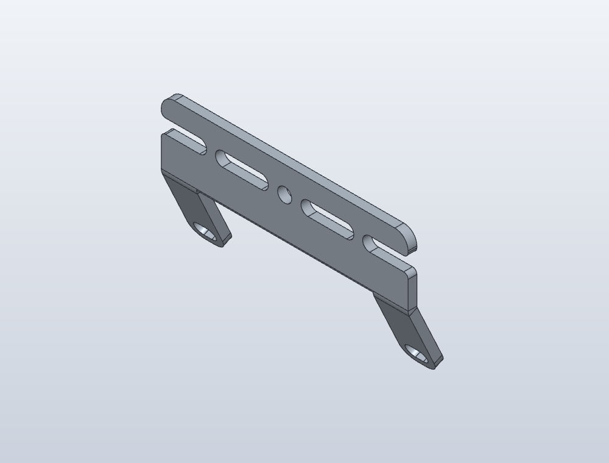

# 感为灰度斜装连接片参考

2026-11-06 从[厂家无 MCU 灰度资料页](https://www.ganv.com.cn/No_MCU_grayscale_8ways.html)的“灰度传感器斜装支架.zip”入口取得，原始 URL 和 SHA-256 见 [source.json](source.json)。

| 文件 | 用途 |
| --- | --- |
| [原厂 ZIP](灰度传感器斜装支架.zip) | 原始下载，内含下面三份文件 |
| [灰度斜装钣金.STEP](灰度斜装钣金.STEP) | 精确实体交换模型 |
| [灰度斜装钣金.STL](灰度斜装钣金.STL) | 原厂网格模型；没有另行生成或改尺寸 |
| [灰度斜装钣金.pdf](灰度斜装钣金.pdf) | 一页钣金图纸，带展开和折弯信息 |

FreeCAD 1.1.4 读取结果为 1 个有效实体，模型轴向包络约 56×9.00×30.86 mm。包络不等于孔距；展开图中的尺寸也不能直接当折弯后包络。

模型与用户照片中的黑色件有相似的槽孔、叉口及折弯结构，当前作为**候选参考**，没有确认与实物完全同款。照片中的白色打印转接架不在这个压缩包内，在本轮查阅的项目与辅助板资料中也未找到同款文件。

这里只保留原始第三方文件并生成查看截图，没有改写模型或装入现有整车总装，未做加工和实物配合验证；第三方文件不据此获得新的开源许可。
