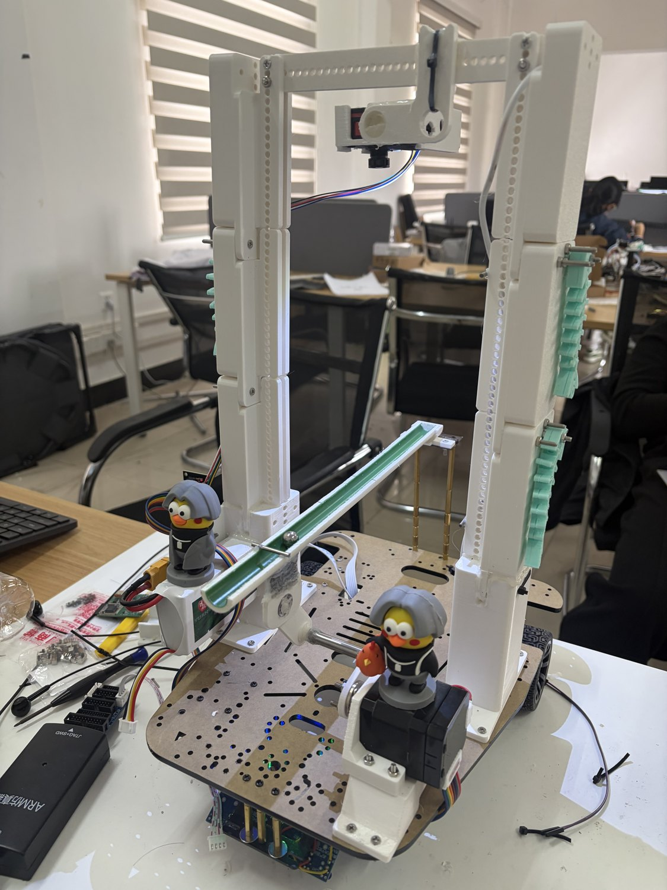
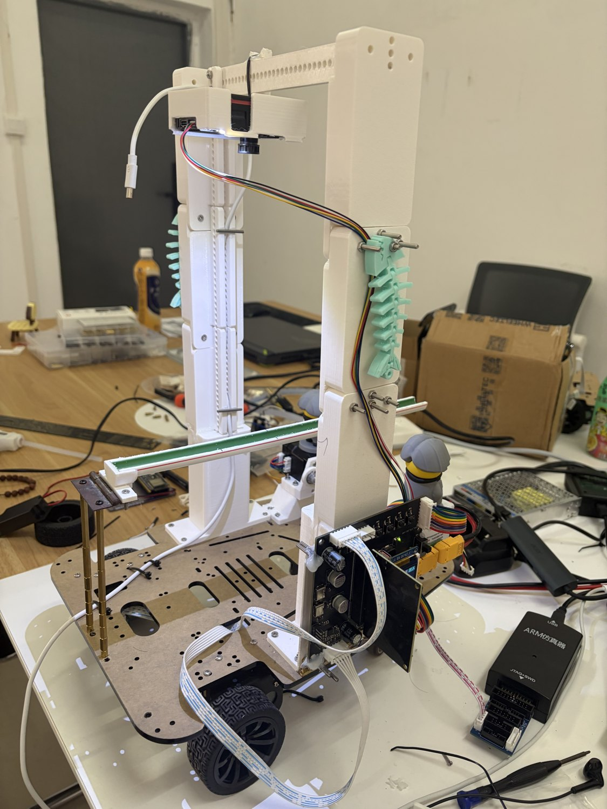

# Coral-C5 · 循线小车与钢球稳控装置

**嵌念万花 · 2026 校赛 A 题 · 已结项**

小车沿黑线行驶，同时让球槽里的钢球停在指定位置。前置八路灰度探头检测赛道，编码器测量左右轮速。MaixCAM2 上报球心，STM32C5A3 控制闭环步进电机，通过曲柄连杆改变球槽倾角。

| 要找的内容 | 入口 |
| --- | --- |
| 读代码、构建固件、操作比赛菜单 | [STM32 C/LL 主控](Firmware/README.md) · [MaixCAM2 识别程序](Firmware/26h/README.md) · [ESP32 语音桥](Firmware/voice/xiaosai.py) |
| 打开电路板、接线或查采购型号 | [三个 KiCad 工程](Hardware/stm32c5a3/README.md) · [实车接线](Documentation/reference/m2-interfaces.md) · [器件选型与采购](Documentation/reference/parts-selection.md) |
| 看整车实物与装配 | [作品图集](Images/README.md#整车与装配) · [设计报告](Documentation/design-report.docx) |
| 查赛题、测量结果或版本 | [基本说明](Documentation/README.md) · [比赛实测](Documentation/validation/README.md) · [最终固件校验值](Firmware/releases/README.md) |

最终实车回读为 **`A9898F82`**，应用长 69,224 字节。第一题依次稳到 O、右 5 cm、左 5 cm。第二题、第四题和发挥一回到 A 点时按黑线标记停车，第三题从 A 到 B 直行 1.5 m，按里程停车。最终版的实车停车误差尚未尺量。

原始比赛视频、提交包和整理前的工程材料可从[结项快照](https://github.com/SmallCoral/c5-car/tree/1b936e16e70845d13a9f0e41dbcd20ecfca4ad00)取回。
